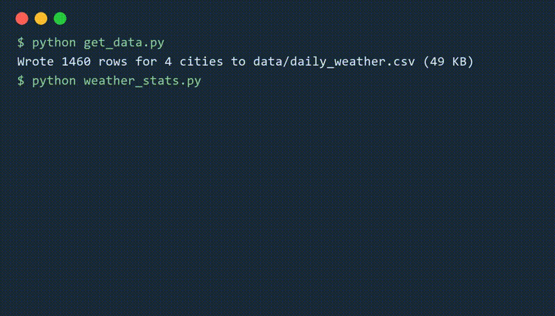

# Weather Stats

A command-line tool that summarises a year of daily weather for several cities and writes an HTML report.
It shows in one table that Mumbai gets more rain in four monsoon months than London gets in a whole year.



## Features

- Mean temperature, the hottest and the coldest day, rainy days and total rain for every city
- Choose the cities on the command line: `python weather_stats.py London Mumbai`
- An HTML report (`output/report.html`) and a JSON summary for other programs
- Unit tests (`python -m unittest`); clear messages for missing data or an unknown city

## Tech stack

| Part | Technology |
|---|---|
| Language | Python 3.14, standard library only (`csv`, `json`, `html`, `pathlib`, `unittest`) |
| Tools | Git, VS Code |

## Getting started

Tested on Windows 11, macOS and Ubuntu with Python 3.12 to 3.14. Nothing to install.

```bash
git clone https://github.com/git-tutorial-demo/weather-stats.git
cd weather-stats
python get_data.py                 # creates data/daily_weather.csv (not stored in this repository)
python weather_stats.py            # the table, plus output/report.html
python -m unittest -v              # 4 tests, all OK
```

On macOS and Ubuntu, type `python3` instead of `python` if `python` is not found.

## Results

| City | Mean | Hottest | Coldest | Rainy days | Rain |
|---|---|---|---|---|---|
| London | 11.4 °C | 26.9 °C | −4.5 °C | 146 | 701 mm |
| Mumbai | 27.5 °C | 40.2 °C | 15.1 °C | 116 | 3,351 mm |
| New York | 12.7 °C | 34.4 °C | −9.1 °C | 112 | 1,017 mm |
| Sydney | 18.4 °C | 33.2 °C | 3.6 °C | 100 | 843 mm |

London has the most rainy days but Mumbai has almost five times the rain, nearly all of it from June to September.
The data set is a generated sample (see *How it works*), so the numbers are realistic but not measurements.

## How it works

`get_data.py` generates one year of daily minimum and maximum temperature and rainfall per city from a seasonal
curve plus random noise (with a fixed seed, so everyone gets the same file). `weather_stats.py` reads the CSV file,
groups the rows by city, computes the statistics, and prints them as a table and as HTML; a day counts as rainy from
1 mm.

## What I learned / what I would do next

- Writing the tests first caught an off-by-one in the rainy-day rule (0.4 mm is not a rainy day).
- Next: download real measurements (for example from a public weather API, with the key in `.env`), and add a chart
  of the monthly temperatures to the report.

## Credits

- Starter code: *Weather Stats* starter project of the tutorial *Git and GitHub for Your Career*.
  My changes: this README, the demo GIF, *(list your own extensions here)*.
- Data: generated by `get_data.py`; it is not stored in this repository.

## License

MIT (see `LICENSE`). The starter project may be reused freely.
